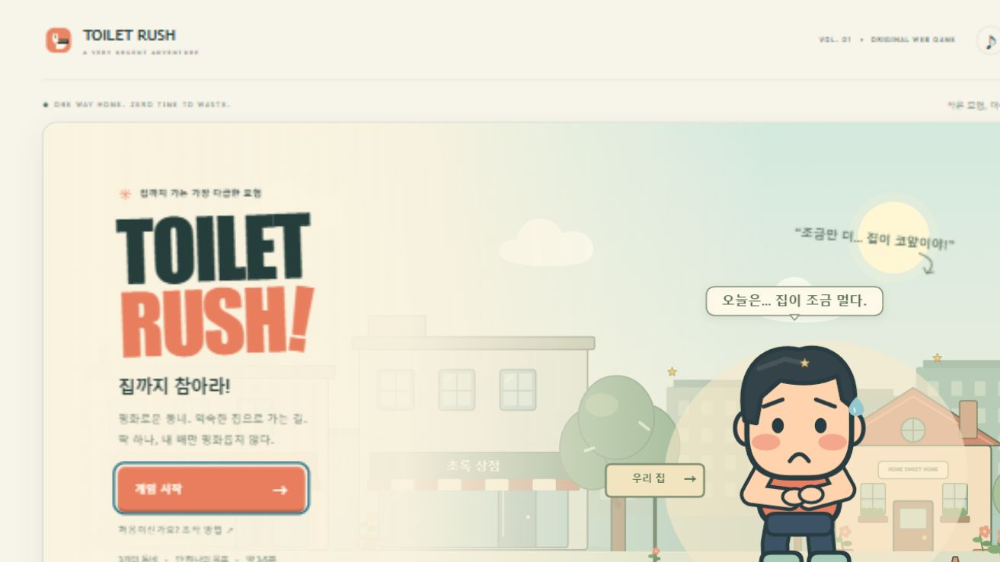
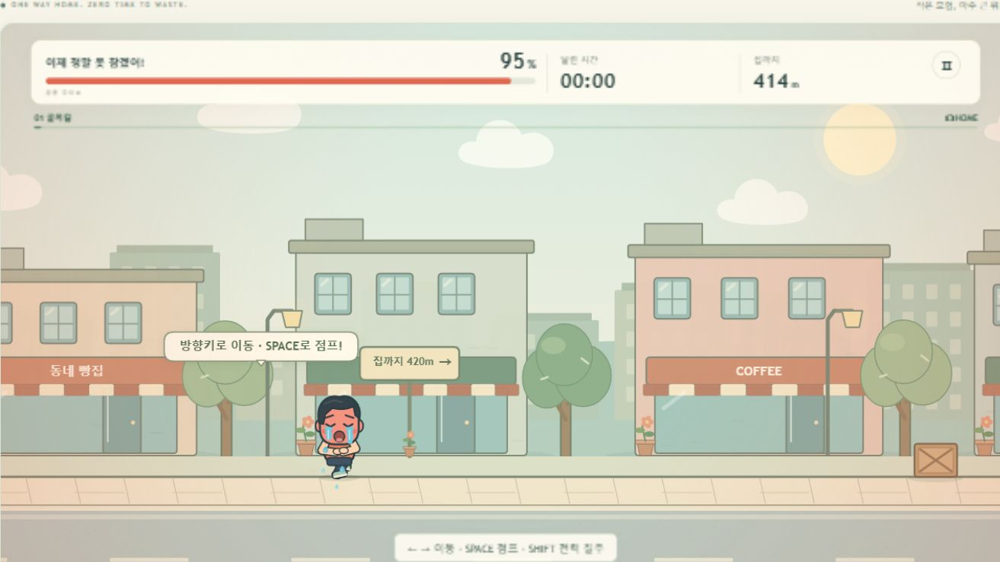

# TOILET RUSH — 집까지 참아라!

설치·로그인·외부 에셋 없이 즐기는 오리지널 2D 횡스크롤 웹게임입니다. 3개의 동네를 지나 **급똥 게이지가 100%가 되기 전에 집 화장실에 도착**하세요.



## 실행

**가장 간단한 방법:** 저장소를 내려받아 `index.html`을 Chrome, Edge, Firefox 또는 Safari에서 엽니다. 게임 실행에는 Node.js나 별도 서버가 필요하지 않습니다. 브라우저가 로컬 파일 저장소를 제한하면 최고 기록은 저장되지 않을 수 있습니다.

개발용 로컬 서버는 Node.js 18 이상에서 다음과 같이 실행합니다. 설치할 패키지는 없습니다.

```sh
npm start
```

[http://127.0.0.1:4173](http://127.0.0.1:4173)을 여세요. 터치 기기에는 이동·점프·질주·화장실 버튼이 표시됩니다. 작은 화면에서는 가로로 돌리면 더 넓게 볼 수 있습니다.

## 조작

| 입력 | 동작 |
| --- | --- |
| A / D 또는 ← / → | 이동 |
| Space | 점프 |
| Shift | 전력 질주 |
| E | 가까운 공중화장실 이용 |
| P / Esc 또는 Ⅱ 버튼 | 일시정지 |
| 1 / 2 / 3 또는 선택지 클릭 | 설문 응답 |
| ♪ 버튼 | 사운드 켜기/끄기 |
| ⛶ 버튼 | 전체 화면 (지원 브라우저) |

가속·감속, 점프 입력 버퍼, 코요테 타임, 착지 애니메이션, 충돌 후 1.5초 무적이 적용됩니다. 다른 창으로 전환하거나 화면을 숨기면 자동으로 일시정지합니다.

## 규칙과 이벤트

- 시작 게이지 25%, 시간 경과 초당 +0.2%, 점프 +1.5%, 충돌 +10%, 구멍 추락 +18%입니다. 질주 중에는 추가로 초당 +0.5%가 오릅니다.
- 일반 이동 기준 약 3분 55초 거리입니다. 질주하면 더 빠르지만 게이지 관리가 더 어렵습니다.
- 골목길 → 번화가 → 주택가를 지나며 차단봉, 예측 가능한 보행자, 구멍, 미끄러운 물웅덩이, 연속 점프 구간을 만납니다.
- 공중화장실은 두 곳입니다. 각각 한 번만 이용할 수 있고 **35% 회복**합니다. 2.2초 이벤트 동안 경과 시간은 흐르지만 게이지 상승은 멈춥니다. 문이 닫힌 뒤 1.05초 시점에 회복합니다.
- 번화가의 필수 설문에는 정답이 없습니다. 3문항을 마쳐야 돌아갈 수 있고, 설문 중에도 시간과 게이지가 오릅니다. 일시정지 후에는 같은 설문으로 돌아옵니다.
- 40%부터 불안·땀, 70%부터 눈가의 눈물, 90%부터 붉어진 얼굴과 흐르는 양쪽 눈물이 표현됩니다. 회복하면 표정도 안정됩니다.
- 100%에 도달하면 이동과 판정이 멈추고 약 3초의 주저앉아 우는 실패 연출이 시작됩니다. 바지 실루엣의 코믹한 변화와 귀여운 똥·파리 애니메이션을 포함합니다.
- 집에 도착하면 집 입장 → 화장실 → 안도 연출 후 시간·게이지·충돌·점프·화장실 횟수와 S/A/B/C 등급을 표시합니다. 최고 기록은 가장 빠른 클리어 시간을 기준으로 브라우저에 저장합니다.
- 사운드는 Web Audio API로 직접 합성한 음악과 효과음입니다. 브라우저 정책에 따라 첫 클릭·키 입력 이후 재생됩니다.

## 검증

```sh
npm test
npm run check
```

브라우저 통합 검증은 서버 실행 후 [http://127.0.0.1:4173/?test=1](http://127.0.0.1:4173/?test=1)에서 **전체 브라우저 검증 실행**을 누릅니다. 검증 패널은 이 URL에서만 표시됩니다. 표정·이벤트 fixture 버튼은 시각 검토를 위한 상태 지정이며, 전체 클리어 검증은 위치·게이지를 바꾸지 않고 일반 이동·점프·화장실 입력과 설문 응답으로 진행합니다. 검증은 기존 최고 기록·사운드 저장값을 복원합니다.

실제 실행 결과와 확인 범위는 [docs/VALIDATION.md](docs/VALIDATION.md)에 기록합니다. 코어 17개 회귀 테스트와 Chromium 브라우저 통합 22개 검사를 통과했습니다. 실기기 iOS/Android와 다른 브라우저의 실행·성능 및 실제 음향 청취는 별도 확인이 필요합니다.



## 구조

| 파일 | 역할 |
| --- | --- |
| `index.html`, `styles.css` | 메뉴·HUD·설문·일시정지·결과·모바일 UI |
| `scripts/engine.js` | DOM과 독립된 물리·레벨·게이지·상태 관리 |
| `scripts/renderer.js` | 오리지널 Canvas 아트·표정·패럴랙스·컷신 |
| `scripts/audio.js` | 오리지널 합성 BGM·효과음·음소거 |
| `scripts/app.js` | 키보드·포인터 입력·UI·기록 저장·게임 루프 |
| `tests/engine.test.cjs` | 상태 회귀 및 전체 경로 시뮬레이션 |
| `tests/browser.js` | 명시적 QA URL의 실제 브라우저 통합 검증 |

## 작업 기록

### 2026-11-10 · v1.0.0

- 처음부터 엔딩까지 반복 플레이 가능한 3구간 게임을 제작했습니다.
- 필수 설문, 2곳의 공중화장실, 5종 장애물 구간, 감정 애니메이션, 실패·승리 컷신과 오리지널 사운드를 구현했습니다.
- 모바일 터치 조작, 일시정지·자동 정지, 재시작, 최고 기록 저장과 검증 도구를 추가했습니다.
- 17개 코어 회귀 테스트와 22개 브라우저 통합 검사를 통과했습니다. 작은 화면에서는 설문·도움말·일시정지 화면을 크게 표시하도록 조정했습니다.

완료한 작업은 검증 결과와 README를 갱신한 뒤 커밋하고 `chanmini584-ux/toilet-rush` 저장소에 푸시합니다.
